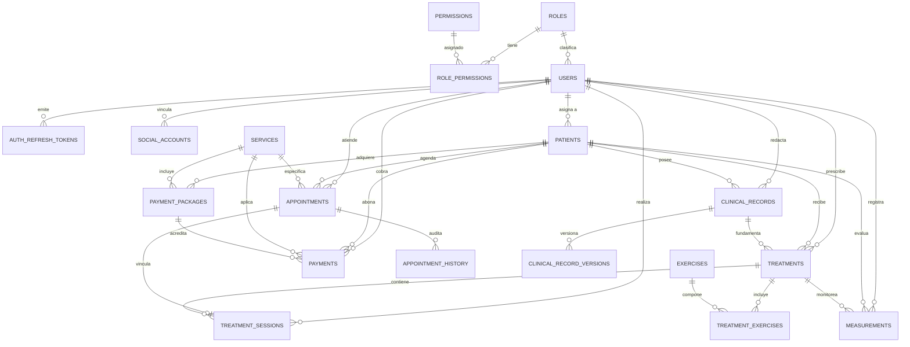

# Documentación de Arquitectura de Base de Datos y Normalización

## 1. Diagrama Entidad-Relación (DER)

---

## 2. Justificación de Formas Normales con Ejemplos Concretos

### Primera Forma Normal (1FN)
*Regla:* Todos los atributos deben contener valores atómicos indivisibles y no deben existir grupos repetitivos ni listas serializadas (e.g. IDs separados por comas).
- **Ejemplo en el modelo:**
  - En lugar de guardar una lista de ejercicios dentro del registro del tratamiento (e.g., `exercises = "1,4,12"`), se creó la tabla relacional `treatment_exercises`, donde cada fila almacena un único vínculo atómico `(treatment_id, exercise_id)` junto a sus parámetros individuales (`custom_sets`, `custom_repetitions`).
  - En la tabla `users` o `patients`, el nombre y apellido están separados en campos atómicos (`first_name`, `last_name`), y los roles no son una lista de strings sino referencias normalizadas a la tabla `roles`.

### Segunda Forma Normal (2FN)
*Regla:* Cumplir 1FN y asegurar que todo atributo no clave tenga dependencia funcional completa de la clave primaria (sin dependencias parciales respecto a claves primarias compuestas).
- **Ejemplo en el modelo:**
  - En la tabla intermedia `role_permissions`, la clave primaria compuesta es `(role_id, permission_id)`. Los datos descriptivos de cada rol (`name`, `description`) no se almacenan allí (lo cual crearía una dependencia parcial de `role_id`), sino en `roles`.
  - En `treatment_exercises`, la descripción genérica y categoría del ejercicio residen exclusivamente en `exercises`, garantizando que en `treatment_exercises` solo figuren atributos que dependen del par `(treatment_id, exercise_id)`, como `custom_sets` y `frequency_instructions`.

### Tercera Forma Normal (3FN)
*Regla:* Cumplir 2FN y asegurar que ningún atributo no clave dependa transitivamente de la clave primaria a través de otro atributo no clave.
- **Ejemplo en el modelo:**
  - En `appointments`, se guarda únicamente `service_id` y `kinesiologist_id`. No se almacena el `duration_minutes` ni el `default_price` del servicio de manera fija en `appointments`, ya que esos atributos dependen funcionalmente de `service_id` (dependencia transitiva `appointment_id -> service_id -> duration_minutes`).
  - En `treatment_sessions`, la sesión referencia a `treatment_id`. Por ende, no se reduplica la columna `patient_id`, ya que el paciente depende funcionalmente de `treatments` (`session_id -> treatment_id -> patient_id`), evitando inconsistencias si el tratamiento es consultado.
